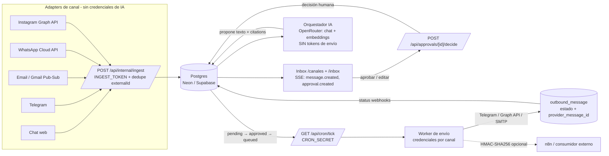

# Arquitectura de Nexo

> **Estado del repositorio (26 Nov 2026):** hoy solo existen `src/lib/contracts.ts`, `src/lib/env.ts`, `src/app/layout.tsx` y la configuración de build. No hay `src/db/schema.ts`, rutas API ni pantallas. Lo que sigue es el **contrato de arquitectura** que el resto de módulos debe cumplir; está descrito como diseño, no como código ya ejecutado y verificado. Las tablas que se mencionan son el modelo previsto.

## Principio rector

Nexo es un **monolito Next.js 15 (App Router)** con **un solo inbox**. No hay Chatwoot ni otro CRM externo. Todo mensaje —de web, Telegram, correo, WhatsApp o Instagram— se normaliza a `CanonicalMessage` (`src/lib/contracts.ts:86`) y entra por un único punto interno (`INGEST_TOKEN`). La IA **propone**, una persona **aprueba**, y un worker **entrega**.

La frontera de seguridad más importante es esta:

> **El proceso que llama a la IA nunca tiene tokens de envío.** No existe una llamada `sendMessage` en el orquestador de IA. La única vía de salida es la tabla `outbound_message`: la IA escribe una propuesta, un humano la aprueba, y el worker de envío (que sí tiene credenciales de canal) lee la fila aprobada y llama al proveedor.

Así, un prompt malicioso en un mensaje entrante no puede convertirse en un envío: entre la propuesta y el envío hay una decisión humana, un estado persistido y una clave de idempotencia.

## Diagrama



## Componentes

| Capa | Responsabilidad | No hace |
|---|---|---|
| Adapters de canal | Verificar firma/secreto del webhook, convertir a `CanonicalMessage`, deduplicar por `externalId` | Llamar a la IA, enviar mensajes |
| Núcleo (`/api/internal/ingest`) | Persistir conversaciones, contactos y mensajes; crear propuesta si `AI_ENABLED` | Tener tokens de envío en el mismo proceso que el modelo |
| Orquestador IA | Recuperar contexto (embeddings), llamar a OpenRouter, guardar `proposal_text`, `model`, `citations` | Enviar nada a un canal |
| Interfaz / inbox | Leer, editar y decidir propuestas; recibir SSE | Invocar APIs de canal directamente |
| Worker `/api/cron/tick` | Expirar propuestas, drenar cola, reconciliar estados `unknown`, renovar watch de Gmail | Generar contenido nuevo con IA |
| Envío | Leer `outbound_message` en estado `queued`, llamar al proveedor, registrar `provider_message_id` y resultado | Decidir qué decir |

## Un solo inbox y un solo mensaje canónico

`CanonicalMessage` exige `externalId`, `channel`, `direction`, `contact.externalId` y `text` (por defecto `""`). El `externalId` es la clave de deduplicación: un mismo webhook reintentado por Meta o Telegram (ambos reintentan) no debe crear dos mensajes. La conversación se agrupa por `conversationExternalId`/`threadKey` cuando el canal lo aporta (número de teléfono, `chat.id`, `IGSID`, hilo de correo).

Los formatos que consume la UI siempre son `{ data: ... }` (`ok()` en `contracts.ts:205`) o `{ error: { code, message, details } }` (`fail()` en `contracts.ts:209`). Los eventos SSE en vivo son los cuatro definidos en `SSE_EVENTS` (`contracts.ts:192`).

## Frontera de credenciales

- Las credenciales de **entrada** (verify token, app secret, secreto de Telegram) se usan **solo** en el route handler del webhook correspondiente.
- Las credenciales de **salida** (bot token de Telegram, access token de Meta, credenciales SMTP) se usan **solo** en el worker de envío.
- La clave de OpenRouter se usa **solo** en el orquestador de IA.
- Los secretos de configuración se guardan cifrados en la tabla de canales y se muestran enmascarados (`secret: true` en `CHANNEL_META`); `ChannelView.fields[].value` nunca debe devolver el plaintext a un cliente no autorizado.
- `JWT_SECRET`, `INGEST_TOKEN`, `CRON_SECRET` y `OUTBOUND_WEBHOOK_SECRET` son variables de entorno; nunca se envían al navegador.

## Ciclo de vida de una propuesta y de un envío

Estados del **mensaje saliente** (previstos en `outbound_message`):

```text
pending → approved → queued → sending → sent
              │          │         │
              │          │         └─→ failed | unknown
              │          └─→ cancelled (si se revoca antes de enviar)
              └─→ rejected / expired (nunca entra a la cola)
```

Y el estado de la **aprobación** ya está definido en `ApprovalView.status` (`contracts.ts:160`): `pending | approved | rejected | expired`.

Reglas:

1. **pending**: la IA propuso un texto; no hay envío posible todavía.
2. **approved**: una persona con permiso (en Telegram, `approverChatIds`) aprobó o editó el texto. Se guarda quién y cuándo.
3. **queued**: se crea la fila en `outbound_message` con una `idempotency_key` única.
4. **sending**: el worker tomó la fila. Debe existir un lock (o `SELECT ... FOR UPDATE SKIP LOCKED`) para que dos invocaciones concurrentes de cron no envíen dos veces.
5. **sent**: se recibió confirmación del proveedor (para Telegram/Graph API, respuesta de la API; para WhatsApp, además, webhook `statuses` con `sent`/`delivered`).
6. **failed / unknown**: ver `docs/runbook.md`. `unknown` significa que no se sabe si el proveedor aceptó el mensaje; nunca se reenvía automáticamente.

## Idempotencia

- Claves naturales: `externalId` del mensaje entrante, `idempotency_key` de cada `outbound_message`, y (cuando aplica) `provider_message_id`.
- Verificar siempre `UNIQUE` en base de datos, no solo en código: los webhooks se reintentan y Vercel Cron puede invocar dos veces la misma ejecución (ver `docs/investigacion.md`, apartado b).
- El cron debe ser **reconciliador**: procesar todo lo pendiente hasta una marca de agua, en vez de «incrementar un contador».

## Expiración de propuestas

`AI_PROPOSAL_TTL_MINUTES` (default 30) define `expiresAt` en `ApprovalView`. Una propuesta vencida pasa a `expired`: no puede aprobarse y el agente debe generar una nueva si todavía tiene sentido. El cron es el encargado de marcarlas; la UI debe mostrar el contador en `expiresAt`. Sin este mecanismo, una aprobación tardía podría enviar una respuesta redactada para una conversación ya cerrada.

## Auditoría append-only

Toda decisión relevante se registra en una tabla de eventos de solo inserción: propuesta creada, aprobación/rechazo/editado, envío intentado, confirmación del proveedor, expiración, rotación de credenciales. No se actualizan ni se borran filas de auditoría. Esto permite responder: «¿quién aprobó este mensaje, con qué texto y en qué momento?». Los webhooks entrantes crudos se conservan el tiempo que marque la política de retención (Meta no ofrece API para recuperarlos después; ver `docs/investigacion.md`, apartado f).

## Webhooks salientes (n8n opcional)

- `OUTBOUND_WEBHOOK_URL` + `OUTBOUND_WEBHOOK_SECRET`: Nexo puede notificar a un consumidor externo (por ejemplo un workflow de n8n) cuando cambia un estado relevante.
- La firma es **HMAC-SHA256** sobre el cuerpo exacto del payload, enviada en una cabecera (p. ej. `X-Nexo-Signature: sha256=<hex>`), con comparación en tiempo constante. El consumidor debe deduplicar por ID de evento.
- El núcleo **no depende** de n8n: si la URL está vacía o falla, el inbox sigue funcionando. `docker-compose.yml` declara n8n bajo el perfil opcional `optional`.

## Límites deliberados

- Sin IMAP IDLE en serverless: el correo se plantea con Gmail Pub/Sub o polling acotado (ver `docs/investigacion.md`, apartado h).
- SSE con reconexión del cliente, nunca un stream infinito: la duración de la función incluye el streaming.
- Un solo inbox: no se replican estados de Chatwoot ni se sincronizan etiquetas con un sistema externo.
- La IA nunca recibe credenciales de envío: es una restricción de arquitectura, no solo una convención de estilo.
